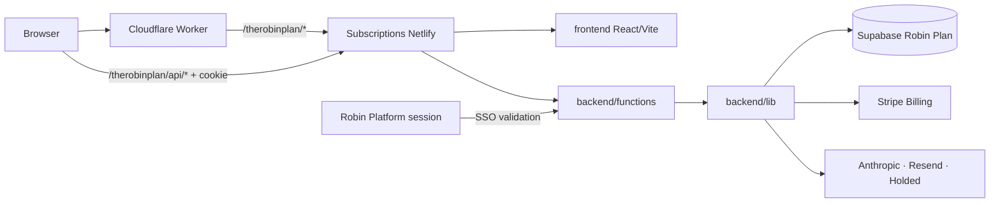

# Robin Subscriptions — guía técnica extendida

> **¿Primera vez en el código?** Empieza por la [USERGUIDE](USERGUIDE.md), que enlaza el recorrido por la sesión propia, el SSO de aplicación, el frontend, la API, billing, datos y routing.
>
> Para seguir una operación entre UI, API, backend y proveedores, consulta [DATAFLOW](docs/DATAFLOW.md); para datos personales, [PRIVACY_DATA_MAP](docs/PRIVACY_DATA_MAP.md).

## Rol y límites

Este repositorio implementa The Robin Plan, una experiencia de suscripción independiente con frontend React/Vite, Netlify Functions y un proyecto Supabase propio. El portal se sirve públicamente bajo `/therobinplan/` en `project-robin.com`. Robin Platform es el proveedor de identidad de aplicación para el handshake SSO; Robin Admin es un producto hermano, no una dependencia de runtime de este proyecto.

El modelo de cuentas, sesiones, DB, secretos JWT y checkout de suscriptor es independiente. No usar la tabla `users` ni el `JWT_SECRET` de Robin Platform como fallback.

## Topología

El router versionado se encuentra en [Robin Platform](https://github.com/RobinManuV/Robin-platform-cliente/blob/main/infrastructure/cloudflare/project-robin-router.js). Detalles de URL y rewrite en [CLOUDFLARE_ROUTING.md](docs/CLOUDFLARE_ROUTING.md).

## Estructura

### Frontend

`frontend/src/main.jsx` monta `frontend/src/app.jsx`. El componente raíz comprueba `/api/me`; si el backend devuelve 401 durante una entrada desde aplicación, intenta `/api/auth/sso`, vuelve a cargar sesión propia y después clasifica al usuario:

- sin sesión → redirige al login común (`/login`, portal del alumno);
- rol `subscriber_admin` → `SubscriberAdmin`, solo si la identidad de aplicación concede la clave `platform.robin_plan`;
- rol `subscriber` → `SubscriberPortal`;
- cualquier rol ajeno → mensaje de incompatibilidad y logout.

`frontend/src/api/index.js` es la interfaz frontend del backend. `application/SubscriberPortal.jsx` es el shell de suscriptor; `application/SubscriberShell.jsx` y `SubscriptionPlanPicker.jsx` soportan layouts/checkout; `CrossPortalNav.jsx` salta entre productos.

`frontend/src/features/` separa autenticación, admin, pagos/suscripción, perfil, careers, services, levels/progreso y community (eventos, mensajes, retos, grupos, partners y social). `frontend/src/shared/` concentra UI, tema, identidad, cookies/client-safe helpers y términos. `frontend/public/` contiene recursos y logos de partner con URL pública.

### Backend y base de datos

- `backend/functions/`: adaptadores HTTP de Netlify; `netlify.toml` enlaza `/api/*` a handlers.
- `backend/lib/`: sesión/principal, Supabase, subscription/billing, Stripe, discounts, HTTP, social, email, Anthropic y logo handling.
- `supabase/migrations/`: esquema privado del producto; `supabase/seeds/` solo contiene filas opcionales de demo.
- `test/`: pruebas Node.js sin credenciales de producción.
- `scripts/`: `check-architecture.cjs`, `generate-docs.cjs`, creación explícita de admin y mantenimiento.

No hay servidor Express; Netlify Functions son toda la superficie backend.

## Identidad y SSO

1. El browser visita `/therobinplan/` y API client usa `/therobinplan/api/*` al detectar el host de producto.
2. La Function de Subscriptions valida su cookie JWT propia.
3. Cuando `/api/me` falla con 401 en el flujo de sesión común, `app.jsx` llama `exchangeApplicationSession()` (`/api/auth/sso`).
4. `backend/functions/auth-sso.js` consulta la sesión de Robin Platform mediante `PORTAL_SUPABASE_*`/API validada; la identidad se enlaza a una cuenta `subscriber` existente según criterios del backend.
5. Solo entonces crea el principal de Subscriptions y su cookie con `JWT_SECRET` propio.

El principal se canonicaliza en `backend/lib/principal.js`; solo `subscriber` y `subscriber_admin` pertenecen al dominio. La autorización de tablas por rol está en `backend/lib/application-permissions.js` y admin handlers; el front no puede concederse acceso a sí mismo.

## Suscripción, comunidad y operaciones

- **Billing**: `subscription-checkout`, `subscription-plans`, `subscription-portal`, `discount-validate` y `stripe-webhook`; lógica en `subscription-billing.js`, `stripe.js`, `discounts.js`. Stripe webhook valida firma; estado local se actualiza de forma reconciliable.
- **Contenido**: FAQs, perfiles, CV assistido por IA y services en handlers específicos; uso de Anthropic y Resend en servicios backend.
- **Community**: social, messages, challenges, events y RSVP poseen API y pantallas; los roles y el ownership se comprueban en cada mutation.
- **Gestión**: `/api/sub-admin/data`, `/mutate`, `/partner-logo`, `/db` es solo para operator con scope fuerte; SQL console usa allowlist de destino y no debe ampliarse sin auditoría.
- **Notificaciones**: endpoints list/ack y popup UI mantienen estado de lectura y acción del usuario.

El catálogo de contratos está en [API_INVENTORY](docs/API_INVENTORY.md), funciones UI en [USERGUIDE](USERGUIDE.md), reglas de permisos en [AUTHORIZATION](docs/AUTHORIZATION.md) y DB en [DATABASE_CURRENT](docs/DATABASE_CURRENT.md).

## Build y publicación

- Requisito Node.js `>=22.13.0`; `.nvmrc` define la versión de referencia.
- `npm run dev` ejecuta Netlify Dev (UI y Functions same-origin) en el puerto 8888; `/` redirige a `/therobinplan/`.
- `npm run dev:frontend` sirve únicamente Vite, sin serverless backend.
- `npm run build` construye workspace `frontend`, escribe SPA en `dist/therobinplan/` y `dist/_redirects` para la ruta DB.
- Netlify publica solo `dist/` y empaqueta `backend/functions/` de acuerdo con `netlify.toml`.
- `npm run verify` ejecuta checks, suite automatizada, build y documentación generada. `npm run docs:generate` reconstruye file/component/API trees.

## Repos relacionados

- [Robin Platform cliente](https://github.com/RobinManuV/Robin-platform-cliente): identity provider / aplicación de origen; [READMELONG](https://github.com/RobinManuV/Robin-platform-cliente/blob/main/READMELONG.md), [USERGUIDE](https://github.com/RobinManuV/Robin-platform-cliente/blob/main/USERGUIDE.md), [Cloudflare paths](https://github.com/RobinManuV/Robin-platform-cliente/blob/main/docs/CLOUDFLARE_ROUTING.md).
- [Robin Admin](https://github.com/RobinManuV/Robin-Admin): panel interno; [READMELONG](https://github.com/RobinManuV/Robin-Admin/blob/main/READMELONG.md), [USERGUIDE](https://github.com/RobinManuV/Robin-Admin/blob/main/USERGUIDE.md), [API mapping](https://github.com/RobinManuV/Robin-Admin/blob/main/docs/API_INVENTORY.md).

Los proyectos se despliegan individualmente. Si cambia SSO, roles, rutas, scopes, producto/checkout o navegación, mantener contrato hacia atrás y coordinar los repos en cambios separados.
