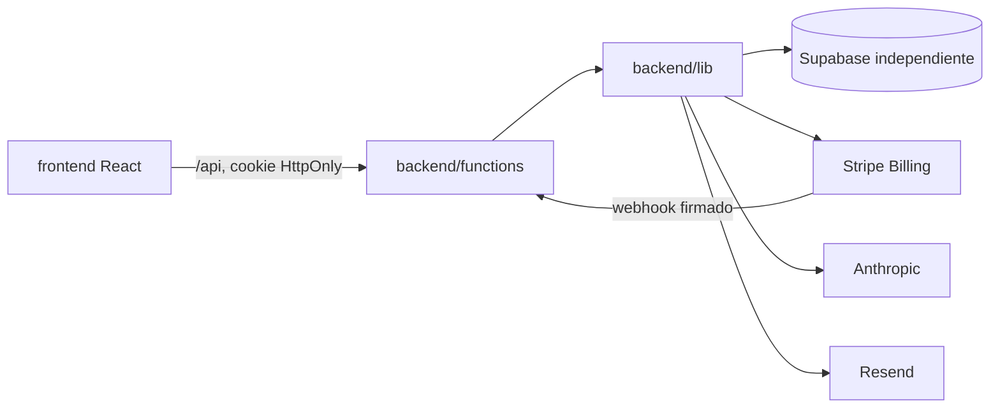

# Arquitectura de Robin Subscriptions

Frontend y backend comparten repositorio y despliegue, no código de proveedores.
`frontend/src/app.jsx` compone sesión y selección entre suscriptor y administrador.
Las funcionalidades se agrupan bajo `frontend/src/features/`; `shared/` contiene
UI, tema y utilidades. Los handlers HTTP están en `backend/functions/` y extraen
servicios comunes a `backend/lib/`.

### Invariantes de composición

- Ninguna Function debe invocar otra Function; los contratos compartidos se extraen a `backend/lib/` para que HTTP siga siendo responsabilidad del handler.
- No forzar que todos los handlers sean controladores mínimos: una separación adicional debe eliminar duplicación o complejidad concreta. Billing, permisos, auth y proveedores son módulos compartidos cuando el dominio lo justifica.
- El shell selecciona una vista según la sesión local. La UI no concede acceso: el backend aplica roles y ownership, y los niveles mostrados no sustituyen autorización.
- Precios, pagos confirmados y estado de suscripción se verifican en el backend y Stripe; los assets y componentes compartidos no contienen secretos.

El portal público vive bajo `/therobinplan/`, con rutas `/api/` en el origin Netlify
que el Worker expone bajo `/therobinplan/api/`. `frontend/vite.config.js` usa base
`/therobinplan/`, crea `dist/therobinplan/` y escribe un redirect adicional para
`/api/sub-admin/db`. El único directorio publicado es `dist/`. No existe un servidor
Express ni una API independiente que desplegar: las Functions son el backend.

La base de datos no debe reutilizarse con el portal de alumnos. Los únicos roles
aceptados en sesiones son `subscriber` y `subscriber_admin`. No hay fallback a `users`.
Al abrir The Robin Plan desde una sesión activa del portal de aplicación, `/api/auth/sso`
valida esa sesión a través de su API y crea una cookie propia únicamente para una cuenta
de suscriptor coincidente por email o `lead_id`. El cierre de sesión elimina las cookies
de los dos portales; no se comparte el secreto JWT entre despliegues.

## Contenido por carpeta

| Carpeta | Contenido |
|---|---|
| `frontend/src/api/` | Fachada API del navegador con cookies same-origin y funciones por endpoint. |
| `frontend/src/application/` | Root shell, portal subscriber, navigation y selector de plan. |
| `frontend/src/features/auth/` | Login/signup/reset y hook para estado/submit de autenticación. |
| `frontend/src/features/subscription/`, `profile/`, `career/`, `services/`, `levels/`, `community/` | Pantallas agrupadas por dominios del producto. |
| `frontend/src/features/admin/` | Admin de usuarios, catálogo, contenido, mensajes, eventos y database console. |
| `frontend/src/shared/`, `assets/`, `public/` | Primitives, tema/session helpers, logos y recursos. |
| `backend/functions/` | Entrypoints de Netlify para auth, pagos, comunidad, servicios y admin. |
| `backend/lib/` | Session/principal, Supabase, billing, Stripe y adaptadores. |
| `supabase/migrations/`, `supabase/seeds/` | Schema y fixtures demo opcionales de este producto. |
| `test/`, `scripts/`, `.github/` | Tests, checks/generadores/tareas operator y CI. |
| `docs/` | Contratos, seguridad, operaciones, guías y árboles generados. |

Para el recorrido por archivo, módulo y endpoint, usa el [USERGUIDE](../USERGUIDE.md)
y el [árbol navegable](codebase/README.md). El mapping desde Cloudflare al origin
Netlify está en [CLOUDFLARE_ROUTING.md](CLOUDFLARE_ROUTING.md).
