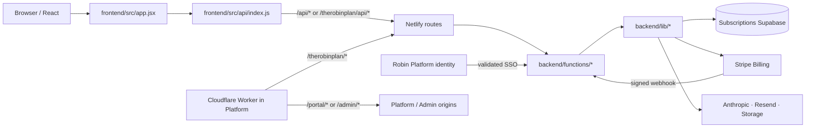

# Dataflow — Robin Subscriptions

Mapa de los recorridos funcionales de The Robin Plan: desde la pantalla hasta su API, handler, lógica backend y destino persistente/externo. Explica también el intercambio de identidad con Robin Platform y el paso por Cloudflare. Confirma cada condición y side effect en el source enlazado; el mapa no reemplaza la revisión de contratos.

> **Alcance:** documentación técnica del comportamiento previsto en el repositorio. La sección de datos personales de [PRIVACY_DATA_MAP.md](PRIVACY_DATA_MAP.md) complementa el flujo con tratamiento, proveedores y limitaciones de retención. No incluye inspección de datos productivos.

## Vista general



Frontend, Netlify Functions, JWT secret, cookie y Supabase de suscriptores pertenecen a este producto. Platform aporta una comprobación de identidad para el SSO, pero Subscriptions crea un principal/cookie local y utiliza sus cuentas/datos propios. Las reglas URL están en [CLOUDFLARE_ROUTING.md](CLOUDFLARE_ROUTING.md) y el Worker versionado se encuentra en [Robin Platform](https://github.com/RobinManuV/Robin-platform-cliente/blob/main/infrastructure/cloudflare/project-robin-router.js).

## Capas y ruta de una petición

```text
frontend/src/main.jsx → frontend/src/app.jsx
  → application shell / feature component
  → frontend/src/api/index.js
  → /api/... → netlify.toml redirect
  → backend/functions/<handler>.js
  → backend/lib/* → Supabase / Stripe / integration
  → JSON/cookie/status → API client → component state
```

El cliente aplica `credentials: same-origin`, mapea errores HTTP y adapta path a `/therobinplan/api/*` cuando la app corre bajo el dominio común. El Worker elimina ese prefijo para llegar al API path que conoce Netlify. En el hostname Netlify directo el URL puede permanecer `/api/*`. Consulta [`frontend/src/api/index.js`](../frontend/src/api/index.js), [`netlify.toml`](../netlify.toml) y [API_INVENTORY](API_INVENTORY.md).

Cada handler es una frontera HTTP: método/origen/parsing, sesión, autorización, validación, side effects y respuesta. La lógica reutilizable vive en `backend/lib/`. El navegador no determina el permiso efectivo.

## 1. Sesión local, login y SSO

### Login local

```text
SubscriberAuthScreen → api.login()
  → POST /api/auth/login → auth-login Function
  → lookup/credential verification → signSession()
  → HttpOnly cookie local → GET /api/me → subscriber principal
```

La UI raíz [`frontend/src/app.jsx`](../frontend/src/app.jsx) inicia la consulta a `/api/me`. Un principal local `subscriber` abre `SubscriberPortal`; `subscriber_admin` pasa además por la consulta de identidad/scope de aplicación antes de recibir el panel autorizado. La lógica del cliente API está en [`frontend/src/api/index.js`](../frontend/src/api/index.js); validación y firma de sesión están en `backend/functions/auth-*`, [`backend/lib/auth.js`](../backend/lib/auth.js) y [`backend/lib/principal.js`](../backend/lib/principal.js).

### Intercambio con Platform

Cuando no hay cookie local, `app.jsx` intenta el exchange SSO tras una respuesta 401. [`backend/functions/auth-sso.js`](../backend/functions/auth-sso.js):

1. Acepta el método/origen previsto y consulta la identidad autenticada de Platform en backend.
2. Busca un subscriber local mediante identificadores permitidos (email y/o `lead_id`).
3. Rechaza identidad ambigua, cuenta ausente, rol ajeno o admin sin el scope requerido.
4. Emite una sesión local con el secret/cookie de Subscriptions.
5. La UI vuelve a pedir `/api/me` y muestra portal local si la sesión ya existe.

El browser no puede escoger el rol ni forzar el enlace por datos enviados en el body. El modelo de principal y permisos se puede seguir por [`backend/lib/application-permissions.js`](../backend/lib/application-permissions.js). Para la mitad proveedora consulta [Platform DATAFLOW](https://github.com/RobinManuV/Robin-platform-cliente/blob/main/docs/DATAFLOW.md); para navegación compartida consulta [Admin DATAFLOW](https://github.com/RobinManuV/Robin-Admin/blob/main/docs/DATAFLOW.md).

## 2. Perfil de suscriptor y funcionalidades

Las pantallas se organizan bajo `frontend/src/features/` y consumen operaciones exportadas por el API client. El flujo base de una lectura/mutación:

```text
feature component → api method → URL from netlify.toml
  → backend Function → require local principal
  → validate ownership/role/input
  → backend/lib service → local table/provider
  → normalized response → component refresh
```

Ejemplos:

- Perfil: `SubscriberPortal` → `subscriberProfileUpdate()` → `/api/subscriber/profile` → [`subscriber-profile-update.js`](../backend/functions/subscriber-profile-update.js) → validación/actualización de perfil → refresh de `/api/me` o vista.
- Servicios: vistas de `features/services/` → API `serviceRequestsList/Create` → [`service-requests.js`](../backend/functions/service-requests.js) → validación de principal y datos del request → persistencia → lista/refresco.
- FAQs y retos: las operaciones se enrutan a sus Functions correspondientes; confirma el parámetro/action usado por el cliente y las ramas GET/POST antes de cambiar autorización o respuesta.

El cliente puede presentar un valor nuevo antes de refresh, pero la persistencia válida se confirma desde respuesta backend. Al modificar un formulario revisa validación server-side, límite de payload, ownership del registro y consumidores que dependen del mismo perfil.

## 3. Suscripciones y billing

### Compra y estado

```text
plan selector → subscriptionCheckout(plan)
  → POST /api/subscription/checkout
  → subscription-checkout Function
  → local principal + plan/price checks
  → backend/lib subscription-billing + Stripe
  → checkout URL → browser
```

Las consultas de planes y el portal de facturación usan handlers separados. El estado autoritativo no procede de que el browser vuelva a una URL de éxito: Stripe emite un webhook firmado a `/api/stripe/webhook`, el backend valida firma/evento e idempotencia, actualiza estado local y después el frontend lo obtiene mediante su API.

Para investigar discrepancia de suscripción sigue, en orden: request de checkout, cliente/price IDs del entorno, resultado de Stripe, webhook recibido, verificación/idempotencia, mutation local, query posterior y estado que renderiza UI. Abre [`backend/functions/stripe-webhook.js`](../backend/functions/stripe-webhook.js), [`backend/lib/stripe.js`](../backend/lib/stripe.js) y [`backend/lib/subscription-billing.js`](../backend/lib/subscription-billing.js). No cambies directamente precios o condiciones solo en React.

Descuentos tienen validación y servicio propios. La campaña/discount elegida por frontend se vuelve a validar server-side al crear checkout; no trates el precio mostrado como autorización para un importe.

## 4. Comunidad, mensajes y notificaciones

- **Social y comunidad:** `features/community/` solicita listas/acciones a `/api/social`, `/api/partners`, `/api/community/events` y `/api/community/rsvp`. Functions llaman reglas de `backend/lib/social.js` u otros módulos, filtran registros por principal/ownership y escriben la acción correspondiente.
- **Mensajes:** los listados y envío se sirven por `/api/messages`; el backend delimita emisor/destinatario y acceso a conversación antes de leer/escribir. No permitas que un ID de usuario dado por el browser otorgue lectura arbitraria.
- **Retos:** `/api/challenges` lista recursos y procesa acciones/entregas; revisa archivo, validación de answer y pertenencia a la cuenta.
- **Notificaciones:** `/api/notifications` lee pendientes y `/api/notifications/ack` confirma estado/acción. La lista y ack son requests diferentes; comprueba idempotencia y refresh de unread count.

Para una feature nueva, inspecciona el handler y sus helpers de permisos; ocultar botón o panel no limita llamadas directas. Comprueba transiciones, recipient scope, estados vacíos, doble submit y consistencia después de guardar.

## 5. Panel local de administración

`SubscriberAdmin` solo se monta tras clasificar la sesión local y validar el scope de Platform requerido. Sus páginas llaman endpoints `/api/sub-admin/*` o APIs de dominio específicas:

- `sub-admin-data` reúne la vista/colecciones permitidas.
- `sub-admin-mutate` valida entidad/acción/campos y ejecuta la mutación de dominio autorizada.
- `partner-logo-upload` valida imagen y partner y usa storage con un path controlado.
- `/api/sub-admin/db` tiene un redirect añadido por la configuración de Vite/output; si cambias esa ruta, comprueba también el artefacto generado y sus restricciones.

El límite de autorización está en [`backend/lib/application-permissions.js`](../backend/lib/application-permissions.js) y las Functions específicas. El panel de base de datos no es autoridad: cualquier consulta o edición se limita en backend mediante allowlist y validación de filas/campos. La UI refleja disponibilidad pero no la concede.

## 6. Carrera, CV con IA, email y archivos

Flujo de CV/IA: usuario aporta datos/documento desde frontend → handler `subscriber-cv-ai` autentica y valida tamaño/campos → servicio backend prepara el contexto mínimo → proveedor Anthropic genera resultado → backend filtra/normaliza respuesta → frontend permite revisión/uso. No envíes al proveedor información que la tarea no necesita, y no registres CV/prompt completo.

Email y notificaciones transaccionales pasan por servicios server-side, con Resend u otro adaptador configurado. El success del proveedor y el estado persistido de la notificación son efectos diferentes; documenta ambos al modificar una operación.

Si se sube imagen/documento, rastrea validación del formato/tamaño, path controlado, storage bucket, metadata y permiso de lectura/borrado. Las URLs firmadas no son URL pública permanente. [PRIVACY_DATA_MAP](PRIVACY_DATA_MAP.md) resume los datos y destinos identificados.

## 7. Errores, retries y datos persistidos

Para cada mutation anota:

| Pregunta | Qué seguir |
|---|---|
| ¿Quién inicia? | componente/form, webhook firmado, cron o admin action |
| ¿Cómo llega? | API client, URL pública, Worker/redirect y Function |
| ¿Quién puede? | sesión local, rol, scope, ownership y allowlist |
| ¿Qué valida? | método/origen, campos, límites, estado previo |
| ¿Dónde cambia? | módulo de dominio, tabla/bucket/proveedor |
| ¿Qué ve el usuario? | status/error, respuesta, refresh y estados UI |
| ¿Qué pasa al repetir? | event ID/idempotency key, upsert, retry o duplicado |

Los webhooks y servicios externos pueden repetir o entregar eventos fuera de orden. La base de datos propia es la fuente de estado local y se reconcilia con Stripe según los handlers. No supongas que el status 200 de un servicio externo prueba que todas las escrituras locales terminaron.

## 8. Rutas públicas y cambios cross-repo

Cloudflare enruta `/therobinplan/*` a este deploy. Conserva el prefijo para la UI porque Vite emite bajo `dist/therobinplan/`; la API pública `/therobinplan/api/*` se transforma a `/api/*` antes de que Netlify aplique su redirect. Una modificación debe concordar con [`frontend/src/api/index.js`](../frontend/src/api/index.js), Vite base/outDir, `netlify.toml` y el Worker versionado en Platform.

Coordina cambios a sesión/perfil con Platform; coordina cambios a rutas compartidas con Admin y Platform. El [API inventory](API_INVENTORY.md), [API contracts](API_CONTRACTS.md), [architecture](ARCHITECTURE.md), [FILE_MAP](FILE_MAP.md) y [codebase tree](codebase/README.md) ayudan a localizar la continuación.

### Referencias

- [USERGUIDE](../USERGUIDE.md) · entrada y capítulos por capa.
- [Arquitectura](ARCHITECTURE.md), [API inventory](API_INVENTORY.md) y [API contracts](API_CONTRACTS.md).
- [Cloudflare routing](CLOUDFLARE_ROUTING.md) y [Operations](OPERATIONS.md).
- [FILE_MAP](FILE_MAP.md) y [codebase index](codebase/README.md).
- [Privacy data map](PRIVACY_DATA_MAP.md).
- [Platform DATAFLOW](https://github.com/RobinManuV/Robin-platform-cliente/blob/main/docs/DATAFLOW.md) · identidad de aplicación.
- [Admin DATAFLOW](https://github.com/RobinManuV/Robin-Admin/blob/main/docs/DATAFLOW.md) · portal administrativo.
