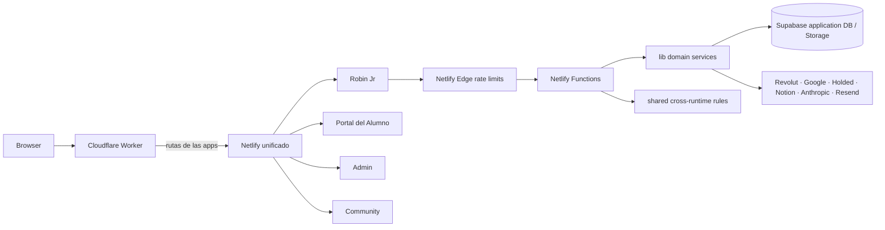

# Robin Jr — guía técnica extendida

> **¿Primera vez en el código?** Empieza por la [USERGUIDE](USERGUIDE.md), un recorrido desde la sesión y la UI hasta Functions, datos, Cloudflare y los contratos con los repos vecinos.
>
> Para los recorridos funcionales completos, abre [DATAFLOW](docs/DATAFLOW.md); para los flujos de datos personales, consulta [PRIVACY_DATA_MAP](docs/PRIVACY_DATA_MAP.md).

## Rol del repositorio

Robin Jr es una app del monorepo para alumnos y equipo administrativo, con
frontend y Functions propios. `site/build.mjs` incorpora su salida al sitio
Netlify unificado. El Worker vigente está en `infra/cloudflare/` de la raíz;
`infrastructure/cloudflare/` dentro de esta app es infraestructura heredada.

Robin Jr utiliza identidad compartida del conjunto Project Robin. Admin y
Community son otras apps del monorepo; Community conserva sus datos de
suscripción por separado.

## Arquitectura de runtime

Cloudflare conserva la web pública para rutas no reconocidas. Las rutas de las
apps llegan al sitio Netlify unificado y el `netlify.toml` generado en la raíz
asigna cada API a su Function.

## Estructura y propiedad

### `portal-source/`

Aplicación React/Vite. `src/main.jsx` arranca React, `src/app.jsx` gestiona sesión, selección de administrador/alumno y onboarding, `src/api.js` es la fachada pública del cliente HTTP y reexporta módulos de `src/api/`. Las pantallas principales están separadas en `src/application/`, onboarding por pasos en `src/application/onboarding/`, administración en `src/application/admin/` y funciones de producto dentro de `src/application/` y `src/application/careers/`. Las reglas de permisos del menú se mantienen en `src/admin-permissions.js`; los controles de servidor siguen siendo autoridad.

Vite construye la UI de Jr bajo `/robinjr/`; el build de raíz la incorpora a
`site/.output/public`. Las APIs usan cookies del mismo origen, excepto las
subidas con URLs firmadas desde backend.

### `netlify/functions/`, `netlify/edge-functions/`, `lib/`, `shared/`

- Functions reciben peticiones, validan método/origen/session/roles y delegan reglas en `lib/`.
- Edge Functions aplican límites de abuso a rutas configuradas antes de entrar al handler.
- `lib/` ofrece integraciones backend y lógica reutilizable (Supabase, identity, pagos Revolut, PDFs, Google, Holded, Drive, calendario, Notion, email, IA y observabilidad).
- `shared/` guarda solo reglas que deben coincidir exactamente entre runtime Node y frontend (contrato, importes, roles y política de contraseña).

La asignación completa route → handler y handler → servicio está en [API_INVENTORY](docs/API_INVENTORY.md), [API_CONTRACTS](docs/API_CONTRACTS.md) y el [USERGUIDE](USERGUIDE.md).

## Flujo del alumno

1. `portal-source/src/app.jsx` llama `apiMe()` mediante `portal-source/src/api.js`.
2. Sin sesión, presenta login o el selector de portal en `/login`; con sesión, clasifica principal y rol.
3. Un alumno nuevo entra al primer paso pendiente de `application/onboarding/`: origen, DNI, contrato, perfil o checkout.
4. Cada paso llama endpoint de `/api/onboarding/*`; Functions accede a Supabase, firma URL de storage y usa proveedores según el paso.
5. El shell Robin Jr muestra resumen, perfil, Mi camino, Mis carreras, Mi plan, documentos, pagos y reservas según el estado de la cuenta.

### Reglas funcionales de Robin Jr

- El progreso contiene nueve fases en este orden: Diagnóstico, Tus resultados, tres sesiones de mentoría con exalumnos, dos sesiones grupales, diagnóstico final con la profesora y Wrap up. `application-steps.js` es la lista visible que debe mantenerse alineada con el backend.
- Mis carreras presenta tarjetas asignadas. El admin crea una ficha con nombre, imagen, descripción, asignaturas y requisitos y después la asigna al alumno. Al abrirla, el alumno ve el detalle en un popup. Los documentos y deadlines no pertenecen a una carrera.
- Mi plan combina eventos próximos y deadlines documentales; las reservas se administran desde Google Calendar y no sustituyen los deadlines de documentos.
- Las altas nuevas del plan Robin Jr cuestan 1.499 € en tres cuotas: 500 €, 500 € y 499 €. Los clientes anteriores conservan 500 €, 500 € y 499,99 €. La cuota 2 se puede habilitar desde la fase 6 y la cuota 3 desde Wrap up (fase 9); la tercera requiere registrar la fecha individual comunicada por escrito.
- Las altas nuevas con `pricing_version=robin-jr-1499-v2` ven y firman el contrato Robin Junior de ocho sesiones para 1.º de Bachillerato; la vista previa y el PDF comparten el mismo contenido. Las plantillas anteriores permanecen para sus versiones históricas.
- Para ofrecer huecos, el advisor crea eventos titulados exactamente `RobinJr` en su Google Calendar. Cada evento genera tramos consecutivos de 60 minutos; al reservar, el backend consulta de nuevo Calendar antes de crear la reunión.

## Flujo de administración

El usuario administrativo de Jr se resuelve en `portal-source/src/app.jsx` y
entra a `AdminPortal` si corresponde. Los componentes consultan API de Jr;
el backend verifica rol y ownership. Robin Admin es otra app del mismo sitio.

## Identidad, persistencia e integraciones

- Cookie HttpOnly firmada en backend; `lib/auth.js`, `lib/identity.js` y `lib/authorization.js` centralizan principales, sesión y guards.
- Supabase es la DB de aplicación y storage; service-role key solo en Functions. Las tablas y accesos se describen en `docs/DATABASE_CURRENT.md` y `docs/AUTHORIZATION.md`.
- Revolut es el proveedor de checkout de aplicación (no Stripe); webhooks validan firma y reconciliación usa estado persistido e ID de pago.
- Google Drive, Sheets, Gmail, Calendar/Meet, Holded, Notion, Anthropic y Resend se encapsulan en `lib/`.
- `webhook_log` y servicios de reintento/idempotencia sostienen eventos externos; no reintentar pagos o emails sin confirmar ID/estado.

## Build, publicación y rutas

- Root package: backend y tooling; `portal-source/package.json`: frontend Vite/React.
- `netlify.toml` instala `portal-source`, construye y copia su `dist/` a `deploy/portal`, además declara funciones, redirects, headers, cron y Edge routes.
- `infrastructure/cloudflare/project-robin-router.js` maneja subpaths globales y preserva WordPress como fallback.
- Las guías existentes cubren operación en [OPERATIONS.md](docs/OPERATIONS.md), configuración en [ENVIRONMENT.md](docs/ENVIRONMENT.md), y flujos de host en [CLOUDFLARE_ROUTING.md](docs/CLOUDFLARE_ROUTING.md).

## Repositorios conectados

| Proyecto | Flujo compartido | Guías |
|---|---|---|
| [Robin Admin](../admin/README.md) | Login, perfiles administrativos, leads, clientes e integraciones administrativas. | [README largo](../admin/READMELONG.md), [USERGUIDE](../admin/USERGUIDE.md), [arquitectura](../admin/docs/ARCHITECTURE.md). |
| [Robin Subscriptions](../community/README.md) | Acceso cross-portal y SSO desde sesión de aplicación; usuario, cookie y base de datos de suscripción siguen separados. | [README largo](../community/READMELONG.md), [USERGUIDE](../community/USERGUIDE.md), [arquitectura](../community/docs/ARCHITECTURE.md). |

Las cuatro apps comparten el build del sitio y algunos paquetes de la raíz,
pero conservan reglas y Functions propias. Los cambios de roles, API o rutas
requieren revisar consumidores en todo el monorepo.
