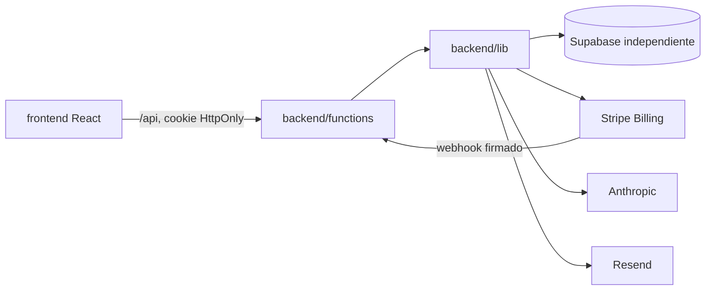

# Arquitectura

Frontend y backend comparten repositorio y despliegue, no código de proveedores.
`frontend/src/app.jsx` compone sesión y selección entre suscriptor y administrador.
Las funcionalidades se agrupan bajo `frontend/src/features/`; `shared/` contiene
UI, tema y utilidades. El backend mantiene los 23 contratos HTTP originales y
extrae servicios comunes a `backend/lib/`.

Se conserva `/portal/` y las rutas `/api/` para no romper enlaces ni la integración
de Stripe. El único directorio público es `dist/`. No existe un servidor Express
ni una API independiente que desplegar: las Functions son el backend.

La base de datos no debe reutilizarse con el portal de alumnos. Los únicos roles
aceptados en sesiones son `subscriber` y `subscriber_admin`. No hay fallback a `users`.
Al abrir The Robin Plan desde una sesión activa del portal de aplicación, `/api/auth/sso`
valida esa sesión a través de su API y crea una cookie propia únicamente para una cuenta
de suscriptor coincidente por email o `lead_id`. El cierre de sesión elimina las cookies
de los dos portales; no se comparte el secreto JWT entre despliegues.
